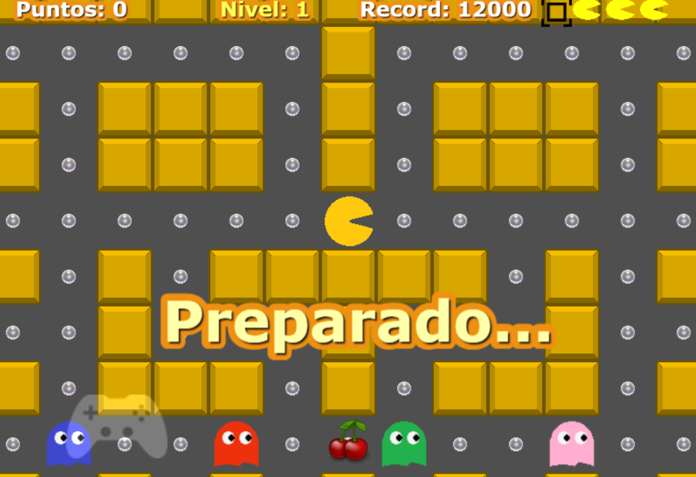

# PacClon

Recreación del juego clásico arcade Pacman de 1980, usando la librería Phaser.

https://juan1639.github.io/PacClon-vite-phaser



# Phaser Vite Template

This is a Phaser 3 project template that uses Vite for bundling. It supports hot-reloading for quick development workflow and includes scripts to generate production-ready builds.

### Versions

This template has been updated for:

- [Phaser 3.90.0](https://github.com/phaserjs/phaser)
- [Vite 5.4.21](https://github.com/vitejs/vite)


## Requirements

[Node.js](https://nodejs.org) is required to install dependencies and run scripts via `npm`.

## Available Commands

| Command | Description |
|---------|-------------|
| `npm install` | Install project dependencies |
| `npm run dev` | Launch a development web server |
| `npm run build` | Create a production build in the `dist` folder |
| `npm run preview` | Serve the production build locally |
| `npm run deploy` | Legacy: build and push `dist/` to the `gh-pages` branch (only useful if Pages is set to that branch) |

## Controls

- **Keyboard:** arrow keys to move, and the on-screen fullscreen button.
- **Touch:** tap the gamepad icon to show the on-screen D-pad, then use it to move.

## Writing Code

After cloning the repo, run `npm install` from your project directory. Then, you can start the local development server by running `npm run dev`.

The local development server runs on `http://localhost:8080` by default. Please see the Vite documentation if you wish to change this, or add SSL support.

Once the server is running you can edit any of the files in the `src` folder. Vite will automatically recompile your code and then reload the browser.

## Template Project Structure

We have provided a default project structure to get you started. This is as follows:

- `index.html` - A basic HTML page to contain the game.
- `src` - Contains the game source code.
- `src/main.js` - The main entry point. This contains the game configuration and starts the game.
- `src/scenes/` - The Phaser Scenes are in this folder.
- `public/style.css` - Some simple CSS rules to help with page layout.
- `public/assets` - Contains the static assets used by the game.

## Handling Assets

Vite supports loading assets via JavaScript module `import` statements.

This template provides support for both embedding assets and also loading them from a static folder. To embed an asset, you can import it at the top of the JavaScript file you are using it in:

```js
import logoImg from './assets/logo.png'
```

To load static files such as audio files, videos, etc place them into the `public/assets` folder. Then you can use this path in the Loader calls within Phaser:

```js
preload ()
{
    //  This is an example of an imported bundled image.
    //  Remember to import it at the top of this file
    this.load.image('logo', logoImg);

    //  This is an example of loading a static image
    //  from the public/assets folder:
    this.load.image('background', 'assets/bg.png');
}
```

When you issue the `npm run build` command, all static assets are automatically copied to the `dist/assets` folder.

## Deploying to Production

`npm run build` generates the production bundle and copies the static assets into `dist/`.

### GitHub Pages (automatic)

`.github/workflows/deploy.yml` publishes `dist/` with `actions/deploy-pages` on every push to `main` (or manually with **Run workflow**):

1. Builds with Node 22 and `npm ci`.
2. Uploads `dist/` as the Pages artifact.
3. Deploys it to the `github-pages` environment.

**One-time setup:** in **Settings → Pages → Build and deployment**, set **Source: GitHub Actions**.

The site is served at https://juan1639.github.io/PacClon-vite-phaser/

`npm run deploy` (gh-pages) is kept only as a manual fallback: it pushes to the `gh-pages` branch, which GitHub Pages ignores when the source is set to GitHub Actions.

### itch.io

Upload the contents of `dist/` (zipped) as an HTML5 project. `base: './'` keeps the build working both on Pages and itch.io.

### Other servers

Upload the contents of the `dist` folder to any static web server.

## Customizing the Template

### Vite

If you want to customize your build, such as adding plugin (i.e. for loading CSS or fonts), you can modify the `vite/config.*.mjs` file for cross-project changes, or you can modify and/or create new configuration files and target them in specific npm tasks inside of `package.json`. Please see the [Vite documentation](https://vitejs.dev/) for more information.

## Join the Phaser Community!

We love to see what developers like you create with Phaser! It really motivates us to keep improving. So please join our community and show-off your work 😄

**Visit:** The [Phaser website](https://phaser.io) and follow on [Phaser Twitter](https://twitter.com/phaser_)<br />
**Play:** Some of the amazing games [#madewithphaser](https://twitter.com/search?q=%23madewithphaser&src=typed_query&f=live)<br />
**Learn:** [API Docs](https://newdocs.phaser.io), [Support Forum](https://phaser.discourse.group/) and [StackOverflow](https://stackoverflow.com/questions/tagged/phaser-framework)<br />
**Discord:** Join us on [Discord](https://discord.gg/phaser)<br />
**Code:** 2000+ [Examples](https://labs.phaser.io)<br />
**Read:** The [Phaser World](https://phaser.io/community/newsletter) Newsletter<br />

Created by [Phaser Studio](mailto:support@phaser.io). Powered by coffee, anime, pixels and love.

The Phaser logo and characters are &copy; 2011 - 2024 Phaser Studio Inc.

All rights reserved.
